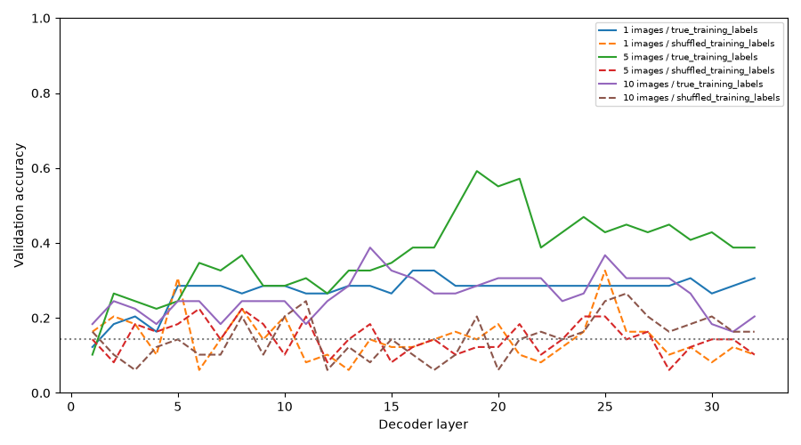

# Looking Beyond Attention

Can Qwen infer a Boolean rule from several pictures? Imagine that every picture contains a red cylinder or both a green cube and a blue sphere. Can the model figure out the shared rule?

In small three-rule controls, Qwen recognized the objects and did well at evaluating given expressions. It scored near chance when asked to infer the hidden rule.

## What I did

I designed the three-operand task and built evaluations with three and seven candidate rules. Both benchmarks use the same three visual concepts. I tested whether Qwen followed the images or the answer order. I also trained probes, swapped internal states, and tested LoRA fine-tuning.

## What I found

| Question | Result |
|---|---|
| Can Qwen find the rule? | In the three-rule controls, both models recognized the objects in all eight images and did well at evaluating given expressions. Hidden-rule accuracy stayed near chance. |
| What happens when the choices move? | In seven-rule validation, pretrained Qwen3.5-4B used only the last two answer positions. It got 48 of 343 answers right. |
| What can we read from its layers? | With five selected images, a classifier read the correct rule from the final layer on 19 of 49 sets. Qwen answered correctly on 7. The images were selected using the true rule. |
| Does fine-tuning help? | LoRA improved seven-rule accuracy from **48/343 to 112/343 (14.0% to 32.7%)** on matched validation prompts. |
| Do internal states affect the answer? | Swapping states changed predictions. The controls gave no convincing evidence that a swap transferred the donor’s rule. |


The LoRA comparison used 49 image sets, each shown in seven answer orders. After training, the model used all seven answer positions. Gains varied by rule. These sets also helped select the checkpoint, so performance on fresh scenes is still open.

**Verify the main result.** [Pretrained predictions](benchmark/results/seven-rules/qwen3.5-4b/operator-controls/predictions.jsonl) · [LoRA predictions](benchmark/results/seven-rules/qwen3.5-4b/lora/finetuned-validation/predictions.jsonl) · [Script to rebuild the plot](docs/plot_lora.py)

<details>
<summary>See the answer-bias and probing plots</summary>




</details>

## Explore the research

- [Three-rule experiments](three-operand-experiments/README.md) cover the first task, its controls, probing, patching, and early LoRA.
- [Seven-rule benchmark](benchmark/README.md) covers the expanded task and the matched LoRA evaluation.
- [Research summary](RESEARCH_SUMMARY.md) explains the evidence, limits, and next test.

## Data

The original 48-image experiments remain available. Later work uses the [1,000-image dataset](https://github.com/SathyaHamsiniP/looking-beyond-attention/releases/tag/dataset-v1):

```bash
python three-operand-experiments/code/00-data-generation/download_dataset.py
```

This creates `three-operand-experiments/data-1000/` with `images/` and `metadata.json`. The release has 800 training and 200 test images. The seven-rule experiments use a saved 800/100/100 train/validation/test assignment and saved ten-image sets; reuse that manifest rather than generating replacements. Images can appear in multiple sets within a partition.

[Image-generation instructions](three-operand-experiments/code/00-data-generation/README.md) describe how the dataset was made.

For run commands and saved outputs, start with the experiment links above.

## Implementation credit

The image generator uses an [upstream renderer](three-operand-experiments/code/00-data-generation/README.md). The Qwen3-VL runs use its [model wrapper and next-token readout](three-operand-experiments/experiments/01-operator-controls/README.md#implementation-credit). Qwen3.5 uses a separate loader.
