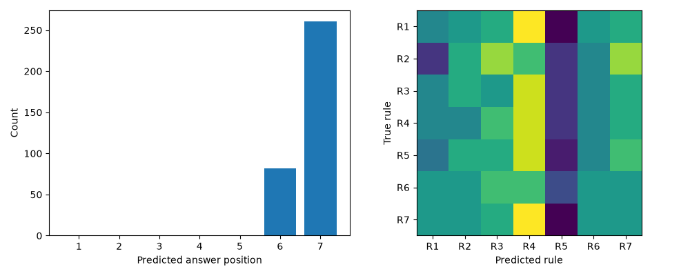
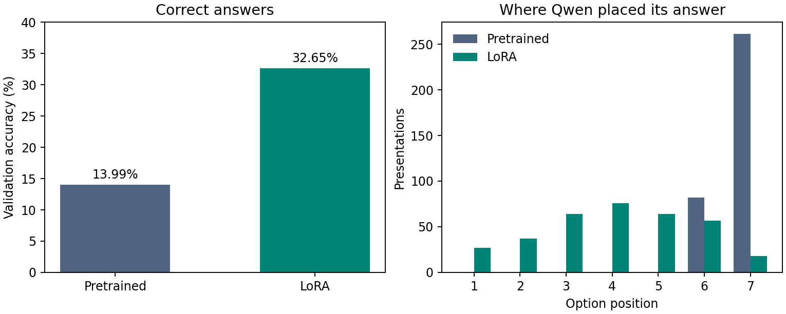

# Looking Beyond Attention

Can a vision-language model work out a rule by looking at several pictures?

Imagine ten pictures. Each contains a red cylinder or both a green cube and a blue sphere. Can Qwen pick that rule from a list? We started with three rules. Qwen did well when we asked about individual objects or gave it the expression to evaluate. Finding the hidden rule was harder. We expanded the task to seven rules to study where its answers went wrong.

| Question | What we observed |
|---|---|
| Does Qwen follow the pictures when the options move? | Pretrained Qwen3.5-4B chose only the last two positions on seven-rule validation. It got 48 of 343 answers right. |
| What can we read from its layers? | With five selected images, a classifier recovered the rule on 19 of 49 sets. Qwen itself got 7 right. |
| Does fine-tuning help? | LoRA raised matched validation accuracy from 13.99% to 32.65%. Two rules accounted for most of the gain. |
| Can we change its answer by swapping internal activity? | Swaps changed answer probabilities. Same-rule controls also shifted them. Which states help Qwen apply a rule remains open. |

### First we moved the answers

Each of 49 image sets appeared in seven answer orders. The pictures stayed the same. Qwen kept choosing the last two positions. Its accuracy was close to chance.



### Then we looked inside

A probe is a small classifier trained on Qwen’s internal activity. At the last layer it got 31% right with one image, 39% with five and 20% with ten. We chose the five images using the true rule. Even a single scene can carry a visual clue about its label.


### What changed after training?

We trained a small set of extra weights with LoRA. Qwen then used all seven answer positions and got 112 of the same 343 presentations right. We also used these validation sets to select the checkpoint. Performance on fresh scenes is still an open question.



Swapping activity between examples gave us a way to test what affects an answer. The completed baseline showed weak evidence for transfer of the donor’s rule. The follow-up after LoRA is in progress. [Baseline patching](benchmark/experiments/08-seven-rule-activation-patching/README.md)

Read the [research summary](RESEARCH_SUMMARY.md), [seven-rule experiments](benchmark/README.md) or [contribution notes](CONTRIBUTIONS.md).

## Data

The original 48-image experiments remain available. Later work uses the [1,000-image dataset](https://github.com/SathyaHamsiniP/looking-beyond-attention/releases/tag/dataset-v1):

```bash
python three-operand-experiments/code/00-data-generation/download_dataset.py
```

This creates `three-operand-experiments/data-1000/` with `images/` and `metadata.json`. The release has 800 training and 200 test images. The seven-rule experiments use a saved 800/100/100 train/validation/test assignment and saved ten-image sets; reuse that manifest rather than generating replacements. Images can appear in multiple sets within a partition.

[Image-generation instructions](three-operand-experiments/code/00-data-generation/README.md) describe how the dataset was made.

## Results and how to run

The [three-operand results](three-operand-experiments/results/README.md) and [seven-rule benchmark results](benchmark/results/README.md) link saved measurements, plots and settings. Repeated three-rule activation-patching files were consolidated without changing their original measurements. Dataset images, large activation arrays and adapters are stored outside GitHub.

The experiment READMEs explain how to run each method. New outputs are saved locally in Colab, printed in the console and then backed up to the School Drive account. See [seven-rule probing](benchmark/experiments/09-seven-rule-probing/README.md) for setup and [LoRA](benchmark/experiments/06-seven-rule-lora/README.md) for checkpoint recovery. Older runners still accept their original configurable data and result paths.

## Credit

This work builds on [Roshan's two-operand experiments](https://github.com/RoshanYSingh23/looking-beyond-attention). Our image generator and Qwen3-VL runs use parts of that public repository. Qwen3.5 uses a separate model loader.
