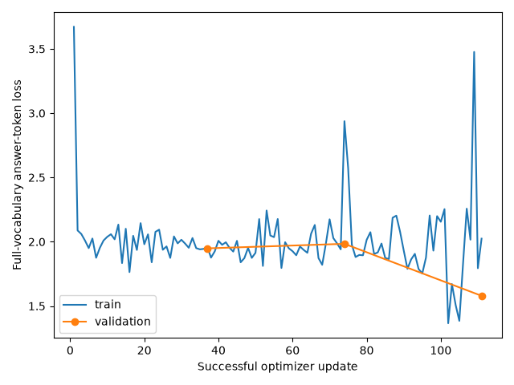

# 06 — Does LoRA help Qwen identify seven rules?

The pretrained model got only 48 of 343 validation answers right. It also chose only the last two answer positions. We fine-tuned Qwen to see whether it could identify the correct rule more often.

We used **LoRA**, which trains small extra weight matrices while keeping the base model fixed. Accuracy increased from **13.99% to 32.65%**. This is a real improvement on these validation examples, but it does not show that the model learned to reason using Boolean logic.

## What we did

We used pretrained **Qwen3.5-4B** and the same saved seven-rule dataset. A, B and C mean a green cube, blue sphere and red cylinder. Each question shows ten images that follow one rule. Qwen chooses from seven rules; the other objects in each image are distractors.

Training used **147 sets**, with 21 sets per rule. Validation used **49 sets**, with seven sets per rule. The test partition was not evaluated. For the final comparison, each validation set was shown with seven answer orders: **49 × 7 = 343 presentations**. The pretrained and fine-tuned models saw the same images, prompts and answer orders.

The base weights used NF4 four-bit quantization, which stores them with fewer bits, and FP16 (16-bit floating-point) computation. LoRA used rank 8, alpha 16 and dropout 0.05. We trained for three epochs, meaning three passes over the training sets. Gradients were accumulated over four sets before each optimizer update. AdamW used learning rate `5e-5`, betas `(0.9, 0.999)`, epsilon `1e-8`, weight decay `0.01` and gradient clipping at 1. The initial gradient scale was 8. The model revision was `851bf6e806efd8d0a36b00ddf55e13ccb7b8cd0a`, with scaled dot-product attention (SDPA), thinking disabled and max pixels 100352. The saved [configuration](../../results/seven-rules/qwen3.5-4b/lora/training/config.json) gives the exact settings and package versions.

## Training and checkpoint choice

The completed run records **111 successful optimizer updates** and **441 training-set presentations**. Every successful update reports finite gradients and changes to all 248 LoRA B matrices. The [training records](../../results/seven-rules/qwen3.5-4b/lora/training/losses.json) preserve those checks.

We chose the checkpoint with the lowest validation answer-token loss at the end of an epoch. This loss measures how much probability the model assigns to the correct answer token across its full vocabulary. We did not choose the checkpoint by validation accuracy.

| Epoch | Validation loss |
|---|---:|
| 1 | 1.948595 |
| 2 | 1.983907 |
| **3 — selected** | **1.579527** |

The loss rose in epoch 2 before falling in epoch 3. The exact selected loss is **1.5795268915137466**. The [selection](../../results/seven-rules/qwen3.5-4b/lora/training/selection.json), [completion record](../../results/seven-rules/qwen3.5-4b/lora/training/complete.json) and fine-tuned evaluation record agree on the selected adapter identity. Adapter weights were not included in the supplied archive, so we could not independently check their recorded hashes.



## Results

| Model | Correct validation answers | Accuracy |
|---|---:|---:|
| Pretrained | 48/343 | 13.99% |
| Selected LoRA, epoch 3 | 112/343 | 32.65% |
| Change | +64 | **+18.66 percentage points** |

Chance accuracy with seven choices is 14.29%. The saved predictions support **112/343**, not the earlier unverified notebook claim of 116/343. The original [comparison summary](../../results/seven-rules/qwen3.5-4b/lora/comparison/summary.json) reports 311 changed predictions.

### Answer-position bias

Before training, Qwen answered only positions 6 and 7. After training, it used all seven positions, though the counts were still uneven:

| Answer position | Before | After |
|---|---:|---:|
| 1 | 0 | 27 |
| 2 | 0 | 37 |
| 3 | 0 | 64 |
| 4 | 0 | 76 |
| 5 | 0 | 64 |
| 6 | 82 | 57 |
| 7 | 261 | 18 |

The model chose the same rule across all seven answer orders for **8 of 49 sets**, compared with **0 of 49** before training. Consistency means repeating the same rule, which can still be wrong.

### Some rules improved more than others

Each rule has 49 validation presentations: seven sets shown in seven answer orders. The rule definitions are in [rules_7.json](../../code/00-common/rules_7.json).

| Rule | Before | After |
|---|---:|---:|
| R1 | 6/49 | 2/49 |
| R2 | 8/49 | 19/49 |
| R3 | 7/49 | 9/49 |
| R4 | 12/49 | 38/49 |
| R5 | 1/49 | 31/49 |
| R6 | 7/49 | 8/49 |
| R7 | 7/49 | 5/49 |

The largest gains were on R4 and R5. R1 and R7 became worse. Most answers were still wrong, so the overall gain should not hide these failures.

## What the results mean

LoRA improved validation accuracy and reduced the extreme preference for the last two answer positions. The results do not prove Boolean reasoning. The model may still use visual shortcuts, rule-specific patterns or answer-position cues.

The 343 presentations reuse 49 image sets; they are not 343 independent samples. Images also repeat within each partition. Validation was used to select the checkpoint, so this is not an untouched final-test score. Earlier three-rule LoRA used two epochs and 46 updates, so it is not a matched comparison with this three-epoch run.

## Files and how to run

The [results README](../../results/seven-rules/qwen3.5-4b/lora/README.md) links the original losses, predictions, metrics and comparison plot. Pretrained predictions are kept once in [operator controls](../../results/seven-rules/qwen3.5-4b/operator-controls/predictions.jsonl). No new measurements or plots were made for this import.

The runner is [lora_7rules.py](../../code/06-lora/lora_7rules.py); its [short code guide](../../code/06-lora/README.md) explains the required inputs. From the repository root, check a saved dataset without loading the model:

```bash
python benchmark/code/06-lora/lora_7rules.py train \
  --data-dir /path/to/data-1000 --out /path/to/saved-run --validate-only
```

The supplied records came from the earlier code layout. Use the [matching original checkout](../../code/README.md#earlier-saved-runs) and package versions to reproduce that run. Keep its saved model, dataset and code hashes unchanged.
