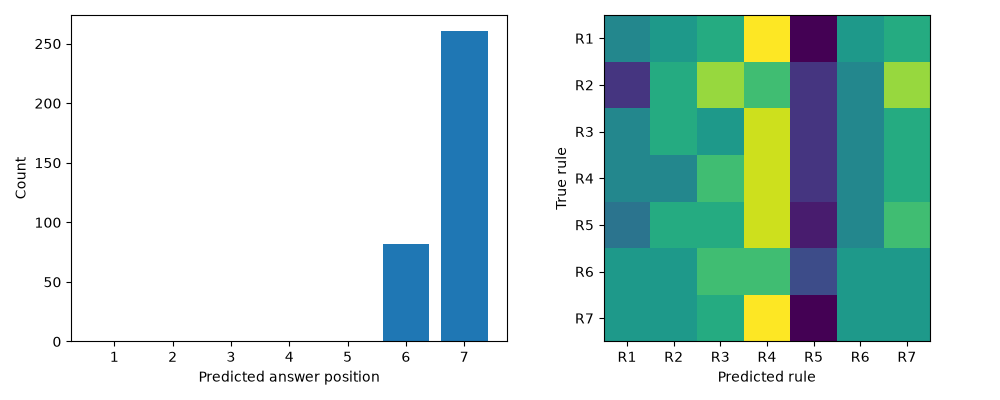

# 07 — Seven-rule operator controls (A3)

Does pretrained Qwen3.5-4B identify seven generating Boolean rules from ten positive images? This extends the existing A1/A2 comparison descriptively; it does not repeat A1 (three rules/three choices) or A2 (the same three rules/seven choices). A3 uses different validation sets, so differences do not isolate the effect of generating-rule count.

Rules are loaded unchanged from [`rules_7.json`](../../rules_7.json): R1 `(A AND B) OR C`, R2 `(A AND C) OR B`, R3 `(B AND C) OR A`, R4 `(A XOR B) OR C`, R5 `(A XOR C) OR B`, R6 `(B XOR C) OR A`, R7 `(A OR B OR C) AND NOT(A AND B AND C)`. A/B/C are green cube/blue sphere/red cylinder, requiring exact colour and shape; other objects are distractors.

## Results

We used the saved `benchmark-pilot/lora-7rules-fp16-retry` manifest and pretrained predictions. All **343 per-example predictions** matched the 49 validation sets, seven rules, seven rotations, pinned model/settings, prompts and inference-code hashes. Recomputed metrics match the saved metrics:

- **48/343 = 13.9942%**, versus chance 14.2857%; chance-adjusted accuracy −0.00340.
- Positions 1–5: zero; position 6: 82; position 7: 261.
- Rule consistency: zero of 49 sets.
- Set-clustered 95% bootstrap interval: approximately 11.9534–16.0350% (5,000 draws, seed 2026).

We calculated these numbers from saved predictions without repeating model inference. The runner checks the saved manifest, model settings, prompts and code hashes, then records current validation-image hashes. The original run stored a whole-dataset fingerprint, so reusing its predictions also assumes the read-only source images have not changed. Test examples are not selected or scored.

The earlier A1/A2 summary reports 36.67% with three choices and 14.76% with seven, both for three generating rules. Those are saved aggregate scores from a different dataset; they do not provide a matched comparison with A3.

### Plots and tables

[Summary](../../results/seven-rules/qwen3.5-4b/operator-controls/summary.json), [all predictions](../../results/seven-rules/qwen3.5-4b/operator-controls/predictions.csv) and [File sources and checks](../../results/seven-rules/qwen3.5-4b/operator-controls/provenance.json).



## How to run

```python
!git clone --branch feature/7-rule-experiments https://github.com/SathyaHamsiniP/looking-beyond-attention.git /content/looking-beyond-attention
%cd /content/looking-beyond-attention
!pip install -r benchmark/requirements-seven-rule-controls.txt
```

For CPU A3 analysis, CUDA/PyTorch is not needed. For later patching, the recovered baseline used **PyTorch 2.14.1+cu130**; check `import torch; print(torch.__version__)` before using GPU quota. The patch runner refuses mismatched inference packages. If needed, install the matching official PyTorch build and restart the runtime; do not silently compare different inference environments.

Mount the School account to read the shared original research folder. Keep source data read-only.

```python
from google.colab import drive
from pathlib import Path
import subprocess

drive.mount('/content/iitm-drive')
SOURCE = Path('/content/iitm-drive/MyDrive/LogicCBM++/source-research')
DATA = SOURCE / 'three-operand-experiments/data-1000'
OLD7 = SOURCE / 'benchmark-pilot/lora-7rules-fp16-retry'
MANIFEST7 = OLD7 / 'dataset/manifest.json'
BASELINE7 = OLD7 / 'evaluations/pretrained/validation'
A12 = SOURCE / 'benchmark-pilot/compare-3-vs-7/summary.json'
LOCAL = Path('/content/seven-rule-controls')
A3OUT = LOCAL / '07-seven-rule-operator-controls'

cmd = ['python','benchmark/operator_controls_7rules.py',
       '--manifest',str(MANIFEST7),'--data-dir',str(DATA),
       '--baseline',str(BASELINE7),'--historical-a12',str(A12),
       '--out',str(A3OUT)]
subprocess.run(cmd + ['--validate-only'], check=True)
subprocess.run(cmd, check=True)  # CPU analysis of saved predictions.
```

If the mount path is absent, recover those exact saved files from Drive before proceeding. Known source IDs: source manifest `1vByMvpzLM61LKKjDCnd_AhFpcQCuCIma`, predictions `1rw6axm_J7B88xIJorIKGNwfL7LHRgb7R`, config `1-pgct8EdA68Kb7yNJaXfJoGiAqAI84kN`, metrics `1YOOXQp4EN7crgtIQaRmnUSVgpbGjmob5`, answer tokens `1V1JZSfapUcWKzMKz9X3zBATUmNiSVloJ`. The older `reconstruct_validation` helper can reconstruct validation sets from existing partitions, but it labels that reconstruction and cannot confirm an old baseline without the original manifest hash. For these experiments, use the saved sets rather than reconstructing them.

The optional `--allow-inference` runs at most 343 forwards. It is unnecessary when the saved predictions are available. If only aggregate scores exist, the runner reports those without deriving per-example comparisons or confidence intervals. Mismatched inputs stop the run.

### Save and upload results

The console prints the input checks, planned work, scores and confidence intervals. Files in `A3OUT` include `summary.json`, readable `summary.md`, plots, CSV and saved validation inputs and baseline probabilities used by experiment 08. No source images or model weights are copied.

Authenticate the **School account `24f2005474@ds.study.iitm.ac.in`** for the Drive API in a notebook cell:

```python
import sys
sys.path.insert(0, '/content/looking-beyond-attention/benchmark')
import iitm_drive
service = iitm_drive.connect(authenticate=True)  # Notebook cell; select School account.
iitm_drive.upload(service, A3OUT, 'operator-controls')
```

Destination is exactly folder `15tnhfEZf-ql6OdiST8ObJIhlSAaso_eR`, with subfolder `07-seven-rule-operator-controls`. The uploader checks actual Drive API email and `canAddChildren` before writes, verifies uploaded IDs/sizes/MD5 hashes, resumes file updates with stable IDs and skips identical bytes. Wrong identity, domain restrictions, quota or write failures stop clearly; there is no old-Drive fallback. If cached API authentication selects the wrong account, use a fresh Colab authentication session and choose IITM; do not bypass the email check.

All important findings remain printed in the console and saved under `/content` **before upload**. If Drive is full or restricted:

```python
!python benchmark/iitm_drive.py --source "{A3OUT}" --manual-zip /content/07-seven-rule-operator-controls.zip
from google.colab import files
files.download('/content/07-seven-rule-operator-controls.zip')
```

This is a local ZIP, not a claimed upload. Manually upload it while signed into IITM at https://drive.google.com/drive/folders/15tnhfEZf-ql6OdiST8ObJIhlSAaso_eR. The saved results were imported from Drive.

## Limitations

Positive-only decisive-scene shortcuts, strong position bias, shared images and previously exposed test images limit reasoning claims. Bootstrap resamples sets to keep rotations together but does not account for shared images across sets. No causal inference about adding generating rules follows from comparing A3 to the old A1/A2 dataset.
