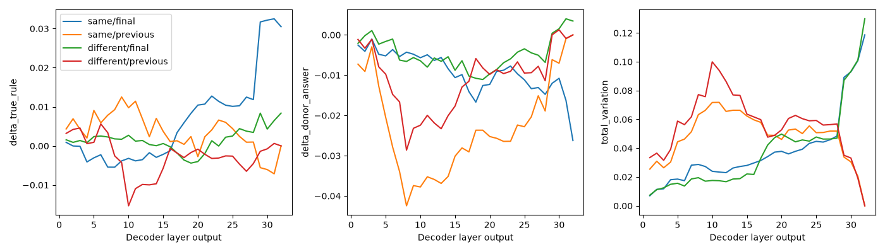

# 08 — Seven-rule activation patching

Does a decoder-output patch increase the probability of the donor's **true** generating rule, copy its original predicted answer, or merely perturb the receiver distribution? These are separate measurements. The earlier three-rule results showed negative signed donor-true-rule effects. That does not prove rule information is absent.

The seven rules and object definitions are unchanged; see [experiment 07](../07-seven-rule-operator-controls/README.md). Only the exact 49 seven-rule validation sets are eligible. No test sets are prepared or scored. A3's saved baseline probabilities supplies unpatched receiver probabilities without repeated inference.

## Method

Default: one receiver per generating rule, one same-rule donor and one different-rule donor each, **14 pairs**, rotation 0, all **32 decoder layers**, and both final/previous answer-prefix tokens. Same/different conditions have seven pairs each, and receiver and donor generating-rule marginals are balanced. Each control group uses the same receiver and donor-index offset for both conditions. The default uses 14 distinct validation sets from the 49-set pool, covering all seven rules; it is not an exhaustive pair matrix. Increasing `--pairs-per-rule` to 7 includes all 49 receiver sets. `--donor-offsets 1 2 3 4 5 6` covers every different-rule offset with matching same-rule controls, at substantially higher cost.

The implementation imports the **existing** `patch_activations_qwen35.py` capture/replacement functions unchanged. An isolated module instance receives a seven-label readout and rule vocabulary. It copies a donor decoder-block **output vector** into exactly one receiver token, preserving the output container and other tokens. Layer numbers are 1-based. Positions `final` and `previous` mean −1 and −2 at the assistant answer prefix, matching the historical semantics. It does not patch attention matrices or train weights.

Seven-rule inputs, pinned Qwen revision `851bf6e806efd8d0a36b00ddf55e13ccb7b8cd0a`, NF4/FP16/SDPA, numeric scoring, thinking disabled and image preprocessing reuse the benchmark helpers. Default model is pretrained. One model load serves the experiment. One donor forward captures both final tokens at all layers; compact vectors stay in CPU RAM, never full sequence dumps on Drive. A two-entry prepared-input cache limits retained GPU inputs. Resuming repeats only necessary donor capture passes and pending interventions; completed measurements are not duplicated.

- Default full workload: **896 patch forwards + 7 donor captures = 903 forwards**, with zero new receiver-baseline forwards.
- Smoke: **8 patch forwards + 2 donor captures = 10 forwards**, testing two conditions, layers 1/32 and both positions.
- Final-token-only full variant: **448 + 7 = 455 forwards**.

The default rotation is deliberately fixed to 0 for T4 cost. Additional rotations are explicit, e.g. `--rotations 0 1 2 3 4 5 6`; the planner prints the increased cost. This is not a rotation-balanced patching result unless all rotations are requested. Pair selection, rotations, layers and positions are saved in config.

## Results

All **896 unique rows** were checked against their saved seven-label probabilities and the 14-pair/layer/position design. [Raw measurements](../../results/seven-rules/qwen3.5-4b/activation-patching/patches.jsonl), [layer effects](../../results/seven-rules/qwen3.5-4b/activation-patching/layer_effects.csv) and [File sources and checks](../../results/seven-rules/qwen3.5-4b/activation-patching/provenance.json) are copied without changing originals.

Different-rule, final-token donor-true-rule mean effects span −0.004397 to +0.008391 probability across layers. They are **not all negative**. At layer 32 the different-rule effect is +0.008391 (+0.8391 percentage points), versus +0.030485 for same-rule controls. The different-rule donor-answer effect is +0.003440; total variation is 0.129835. At that layer previous-token effects are zero. These small, heterogeneous effects do not establish causal Boolean reasoning; same-rule controls also move probabilities. Fixed rotation and only seven pairs per condition limit generalization.



## How to run

First follow experiment 07's fresh-runtime installation, read-only source mount, input checks and CPU analysis of A3. Its variables `DATA`, `MANIFEST7`, `LOCAL`, `A3OUT` and `ORIGINAL` are used here. The saved controls cache requires that matching original checkout. For a new matching cache, the moved runner is `benchmark/code/08-activation-patching/activation_patching_7rules.py`. CPU planning with the moved runner works without `--run`; resuming a saved patching run requires its original code hashes.

```python
PATCHOUT = LOCAL / '08-seven-rule-activation-patching'
PATCH_RUNNER = ORIGINAL / 'benchmark/activation_patching_7rules.py'
base = ['python',str(PATCH_RUNNER),
        '--manifest',str(MANIFEST7),'--data-dir',str(DATA),'--cache',str(A3OUT)]

# Plans and validation only; neither command loads Qwen.
subprocess.run(base + ['--out',str(PATCHOUT/'smoke'),'--smoke'], check=True)
subprocess.run(base + ['--out',str(PATCHOUT/'pretrained')], check=True)

# Explicit GPU permission, after reviewing the printed estimates.
subprocess.run(base + ['--out',str(PATCHOUT/'smoke'),'--smoke','--run'], check=True)
subprocess.run(base + ['--out',str(PATCHOUT/'pretrained'),'--run'], check=True)
# After interruption:
# subprocess.run(base + ['--out',str(PATCHOUT/'pretrained'),'--run','--resume'], check=True)
```

The smoke check verifies decoder count, hook output shapes, hidden dimensions, token positions and readout. Fresh donor probabilities must agree with the recovered baseline within `1e-5`; its top prediction must also agree. The recorded inference package versions must match. Mismatches stop rather than silently mix runs. Completed resume performs analysis without loading the model.

The optional `--optional-training-root` selects a separate fine-tuned run only after `require_selection` verifies the exact seven-rule manifest/config, 111 successful updates, three validation-loss observations, minimum-loss selected epoch and recorded adapter identities. A missing complete adapter is reported and skipped. A smoke adapter is never accepted. Selected-model runs compute their own matched unpatched baselines and record a distinct adapter identity; do not reuse pretrained probabilities. Use a separate output subdirectory, e.g. `PATCHOUT/'selected-seven-rule-adapter'`. The saved training files contain no completed selection or best adapter, so this optional comparison is unavailable now.

## Method details

Effects are **patched probability minus original receiver probability**. Each row records donor true rule, donor predicted rule, donor predicted numeric label, receiver original rule prediction, patched rule prediction, and all seven before/donor/after probabilities.

- `delta_true_rule`: signed shift for the donor's generating rule.
- `absolute_delta_true_rule`: magnitude of that shift.
- `delta_donor_answer`: shift toward the donor's original predicted numeric answer, which may be wrong.
- `total_variation`: half the L1 distance between distributions, measuring generic perturbation.
- `top_rule_changed`: whether the receiver's top rule changes.

Console output prints planned/pending forward counts, capture progress, each completed intervention and final per-layer tables. Files include fixed settings, workload estimates, resumable `patches.jsonl`, detailed CSV, per-layer CSV/PNG, matched same/different controls and late-layer control-adjusted summaries. Rows identify both rules and pair IDs for per-rule/per-pair inspection. Uncertainty averages rotations within donor–receiver pairs and bootstraps pairs or matched control groups (5,000 draws, seed 2026). Late-layer summaries compare layers 25–32 against 1–8 after subtracting same-rule controls; this is descriptive, not proof of significance or a uniquely logical layer.

Pairs can reuse sets/images, and same-rule pairs can share more images. Shared-image counts are recorded. Pair-bootstrap intervals do not remove this dependency. Fixed rotation, answer-position bias, donor prediction errors, representation mismatches, numerical tolerance and output-vector intervention artifacts confound interpretation. Negative true-rule shifts do not disprove representations; donor answer copying does not establish Boolean reasoning.

### Save and upload results

Authenticate and verify IITM as described in experiment 07, then upload only compact results:

```python
service = iitm_drive.connect(authenticate=True)  # Notebook cell.
iitm_drive.upload(service, PATCHOUT, 'activation-patching')
```

All uploads target `24f2005474@ds.study.iitm.ac.in`, exact parent folder `15tnhfEZf-ql6OdiST8ObJIhlSAaso_eR`, subfolder `08-seven-rule-activation-patching`. File IDs, parents, sizes and MD5s are API-verified. Repeating the command skips unchanged files and updates stable IDs for changed/interrupted transfers; no checkpoint or activation binaries are included.

Console findings and local `/content` files survive upload failure. If quota or organization restrictions block access:

```python
!python benchmark/code/tools/iitm_drive.py --source "{PATCHOUT}" --manual-zip /content/08-seven-rule-activation-patching.zip
files.download('/content/08-seven-rule-activation-patching.zip')
```

The saved experiment is complete; editing this documentation does not rerun patching. CPU tests check the hooks, probability changes, pair selection, summaries, interrupted runs and upload account checks.
