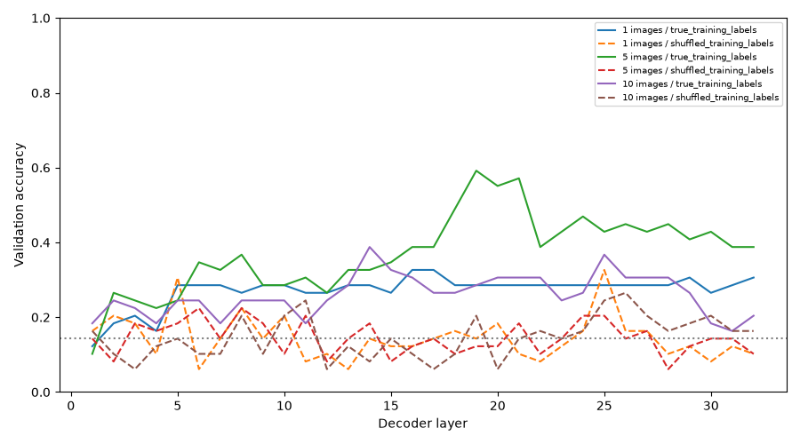

# 09 — What does Qwen know about the rules, even when it gets the answer wrong?

In [experiment 07](../07-seven-rule-operator-controls/README.md), Qwen struggled to choose the correct rule. It was often drawn to the last answer option instead of the rule suggested by the pictures.

But a wrong answer does not tell us everything about what is happening inside the model. Maybe Qwen has picked up something about the rule, but that information is not making it into its final answer.

This experiment tries to find out.

## The idea

We show Qwen pictures that follow one of our [seven Boolean rules](../../rules_7.json). Instead of looking only at its answer, we save the information it has built up at different layers inside the model.

We then train a small, separate classifier, called a *probe*, to guess the rule from that saved information. **Qwen itself is not trained or changed.** If the probe can identify the rule, that suggests some clues about it are present inside Qwen, even if Qwen does not use them to answer correctly.

We also train probes with deliberately shuffled training labels. If those do just as well, the good scores might be a coincidence rather than useful rule information.

## What we tried

We compared three ways of showing the pictures:

- **One image:** not enough to tell which rule generated it. This checks whether a probe finds patterns even when the rule cannot be determined logically.
- **Five images:** chosen to distinguish the correct rule from the other six. Importantly, the selection uses knowledge of the correct rule.
- **Ten images:** the original complete set of pictures.

We saved Qwen's representations at all 32 layers, then fitted probes on the saved training sets and checked their predictions on separate validation sets. We did not use the reserved test sets.

## What happened

Qwen's own answers were still close to random guessing. On the validation examples, it got **7 out of 49 right** in each image condition and nearly always selected the last answer option.

But the probes did better in some cases:

| Pictures shown | Probe at final layer | Probe with shuffled labels |
|---|---:|---:|
| 1 | 30.6% | 10.2% |
| 5 | 38.8% | 10.2% |
| 10 | 20.4% | 16.3% |

For comparison, guessing among seven rules would give about **14.3%** on average.



The five-image probes were the strongest at the final layer, and some middle layers performed better than the final layer. But that is not automatically evidence of reasoning. The five images were selected with the answer already known, and the one-image probes did better than chance even though a single image cannot uniquely identify the rule. That tells us there may be shortcuts or other patterns in the data.

The [saved summary](../../results/seven-rules/qwen3.5-4b/probing/probes/summary.json), [layer scores](../../results/seven-rules/qwen3.5-4b/probing/probes/layer_accuracy.csv), and [individual probe predictions](../../results/seven-rules/qwen3.5-4b/probing/probes/probe_predictions.csv) show the results in more detail. The full set of extracted features and associated metadata belongs in the same [results folder](../../results/seven-rules/qwen3.5-4b/probing/README.md).

## How to run

You need the saved image dataset and its original manifest, a compatible GPU and the model's recorded software environment. From the repository root:

```bash
pip install -r benchmark/requirements-seven-rule-controls.txt
python benchmark/probing_7rules.py --manifest PATH_TO_MANIFEST --data-dir PATH_TO_DATA --out PATH_TO_OUTPUT
```

The script saves the model's internal features and then fits the probes. If extraction is already complete, add `--fit-only` to fit the probes again without loading Qwen. Keep generated outputs outside the repository until you decide which results to commit.

## What this tells us

There is some information related to the correct rule in Qwen's internal representations that its final answer does not seem to use reliably. **That does not mean we have shown that Qwen understands or applies Boolean logic.** A probe can learn from dataset patterns, the images are reused across sets, and these results are from one fixed answer order. We would need more careful controls to tell those explanations apart.
