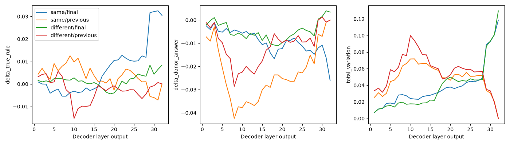

# Seven-rule activation-patching

Pretrained, rotation 0, 14 pairs, 32 layers, two token positions: 896 verified rows. [Raw patches](patches.jsonl), [layer effects](layer_effects.csv), [summary](summary.json), [provenance](provenance.json). See [08](../../../../experiments/08-seven-rule-activation-patching/README.md) for interpretation.

