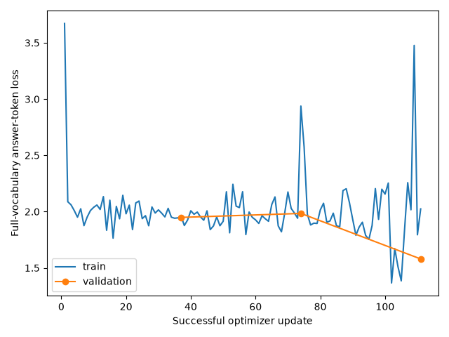

# Seven-rule LoRA results

We fine-tuned Qwen3.5-4B to see whether it could identify the rule shared by ten images more often. Validation accuracy increased from **48/343 (13.99%)** to **112/343 (32.65%)**, a gain of **18.66 percentage points**.

The run completed **111 successful optimizer updates** over three epochs. **Epoch 3** was selected by the lowest validation answer-token loss, **1.5795268915137466**. The completion and evaluation records contain the same adapter identity. Its weights were not supplied, so their hashes could not be independently checked.

## Original files

- Training: [settings](training/config.json), [losses and successful-update checks](training/losses.json), [validation losses](training/validation_losses.json), [completion](training/complete.json), [checkpoint selection](training/selection.json), [trainable parameters](training/trainable.json) and [answer tokens](training/answer_tokens.json).
- Fine-tuned validation: [settings](finetuned-validation/config.json), [metrics](finetuned-validation/metrics.json) and [all 343 predictions](finetuned-validation/predictions.jsonl).
- Comparison: [original summary](comparison/summary.json) and [original loss plot](comparison/loss_curves.png). No original matched-prediction CSV was supplied; none was invented.
- Pretrained validation: [predictions](../operator-controls/predictions.jsonl) and [settings](../operator-controls/recovered_config.json), kept once in operator controls. These are byte-for-byte identical to the baseline in the uploaded archive.
- [File sources and checks](provenance.json): archive checksums, original file hashes, matching validation inputs and the limits of what was checked.

## What changed and what remains unclear

The fine-tuned model used all seven answer positions instead of only positions 6 and 7. R4 and R5 improved most; R1 and R7 became worse. Most validation answers were still wrong. The [experiment README](../../../../experiments/06-seven-rule-lora/README.md) gives the answer counts and per-rule results.

The **112/343** count replaces the earlier unverified claim of 116/343. The 343 presentations reuse 49 image sets across seven answer orders, and images also repeat within partitions. Validation selected the checkpoint; the reserved test partition was not evaluated. Better validation accuracy alone does not show Boolean reasoning.

The original files were copied without changing their bytes. Earlier partial-training records were replaced; they remain in Git history. Model weights, optimizer state, smoke tests, datasets and ZIPs are excluded. The complete source archives remain outside GitHub.
