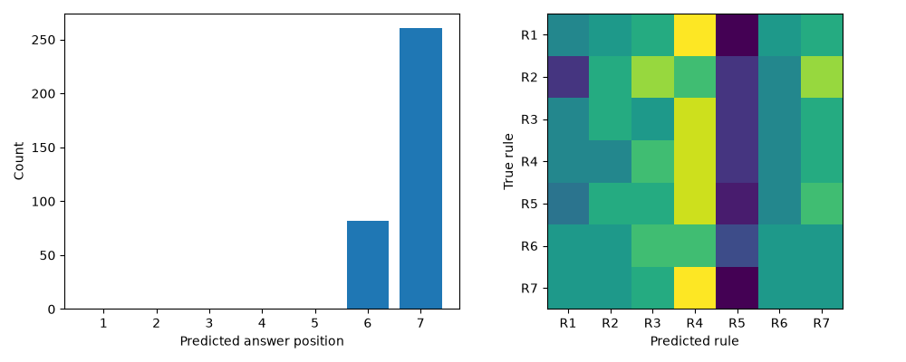

# Seven-rule operator controls

Pretrained, seven rules/options, 49 validation sets × seven rotations: 48/343 correct, positions 6=82 and 7=261, consistency 0/49. [Summary](summary.json), [predictions](predictions.csv), [File sources and checks](provenance.json).

