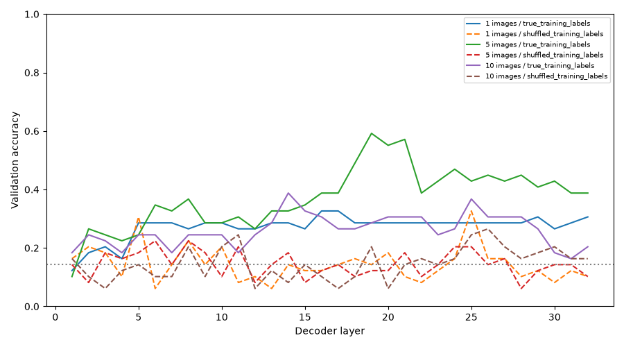
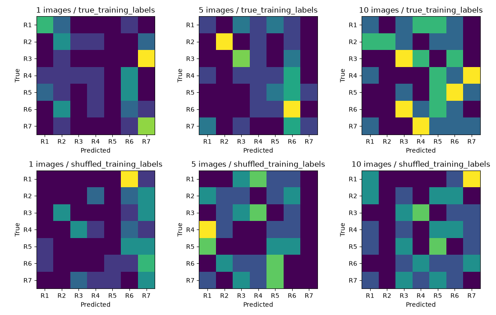

# Seven-rule probing results

These are the results of [experiment 09](../../../../experiments/09-seven-rule-probing/README.md): can a small classifier read the correct rule from Qwen's internal activity, even when Qwen's own answer is wrong?

**The run is complete.** We extracted the saved activity from all 32 layers of pretrained Qwen3.5-4B, then trained and evaluated separate probes on the seven-rule dataset. The original results came from the IITM Drive archive `09-seven-rule-probing.zip` (11 November 2026). The ZIP's integrity check passed, and all 588 feature files matched their saved SHA-256 checksums.

## What we found

| Images shown | Qwen's own answer | Final-layer probe | Shuffled-label probe |
|---|---:|---:|---:|
| 1 | 7/49 (14.3%) | 15/49 (30.6%) | 5/49 (10.2%) |
| 5 | 7/49 (14.3%) | 19/49 (38.8%) | 5/49 (10.2%) |
| 10 | 7/49 (14.3%) | 10/49 (20.4%) | 8/49 (16.3%) |

With seven possible rules, chance accuracy is about 14.3%.

Qwen mostly picked the last answer option. Its final-layer representations, however, held some information that a separately trained probe could use to predict the rule. The five-image condition did best at the final layer. The strongest individual layer score was **29/49 (59.2%) at layer 19 with five images**, but that layer was found by examining validation scores and is not an independent test result.

## How to read this

The model's internal information appears more useful for identifying rules than its own answers suggest. Still, this does **not** show that Qwen reasons through the rules. One image is not enough to identify a rule logically; the five-image examples were selected with knowledge of the correct rule; some source images appear in multiple sets; and the answer order stayed fixed. The shuffled-label probes also sometimes scored above chance. We did not evaluate the reserved test data.

## Files

The complete [IITM Drive ZIP](https://drive.google.com/file/d/1sPEeKrm3q2nUDKYvpipe6xViIZ_Y41LQ/view) preserves all 588 `features.npz` arrays with their matching `metadata.json` files. These large intermediate arrays are **not part of the compact GitHub results**. The files listed below are the original compact results selected for GitHub:

- [Layer accuracy](probes/layer_accuracy.csv) — accuracy at each of the 32 layers
- [Individual probe predictions](probes/probe_predictions.csv) — predictions for each validation set
- [Rule-by-rule accuracy](probes/per_rule_accuracy.csv) and [confusion tables](probes/confusion_matrices.csv)
- [Probe summary](probes/summary.json) and [probe settings](probes/config.json)
- [Original Qwen predictions](model_predictions.jsonl) and [input report](input_report.json)
- [Original source ZIP](https://drive.google.com/file/d/1sPEeKrm3q2nUDKYvpipe6xViIZ_Y41LQ/view) — all 588 frozen feature arrays with their metadata, kept outside GitHub

See the [experiment README](../../../../experiments/09-seven-rule-probing/README.md) for a plain-English explanation of how we ran the experiment. These files are saved measurements, not new model training.
