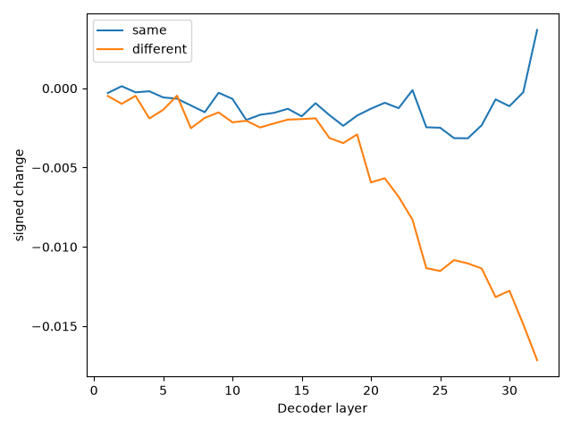

# Three-rule activation-patching

Historical three-rule interventions: 3,456 rows. [Raw patches](raw/patches.csv), [saved summary](raw/summary.json), [verified findings](derived/verified_findings.json), [provenance](provenance.json). Original tracked results are unchanged.

