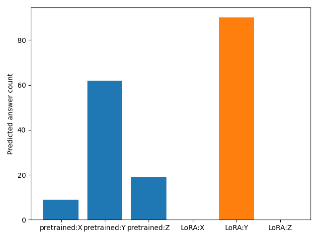
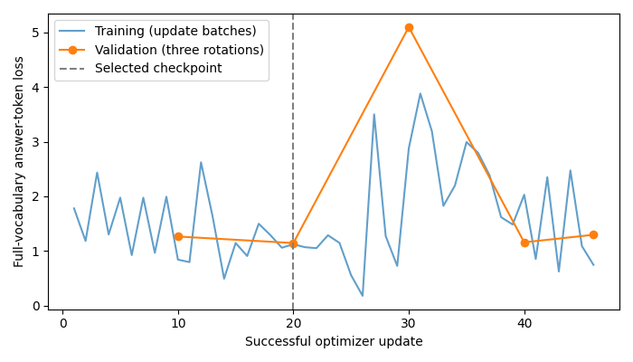

# Three-rule LoRA

Two epochs and 46 successful updates; validation 29/90 pretrained versus 30/90 selected LoRA. The selected adapter always answers Y. [Comparison](comparison/comparison.json), [matched predictions](comparison/matched_predictions.csv), [analysis](derived/analysis.json), [File sources and checks](provenance.json). Not comparable to seven-rule training at 111 updates.

