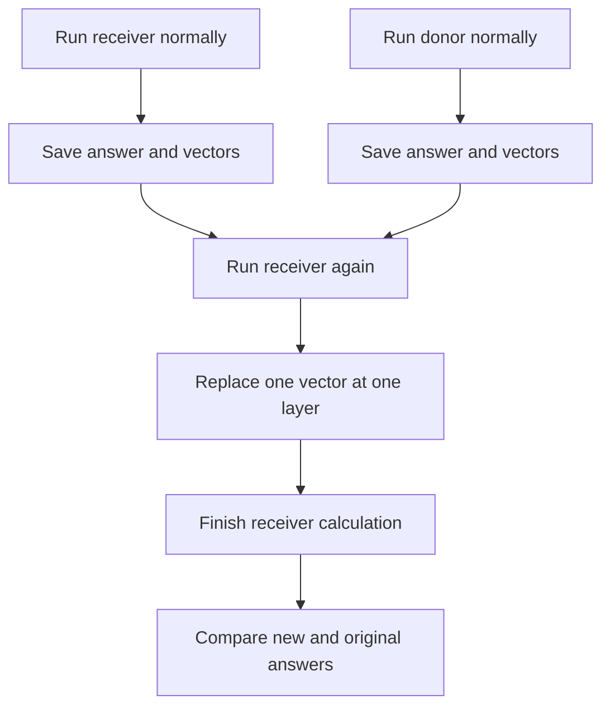
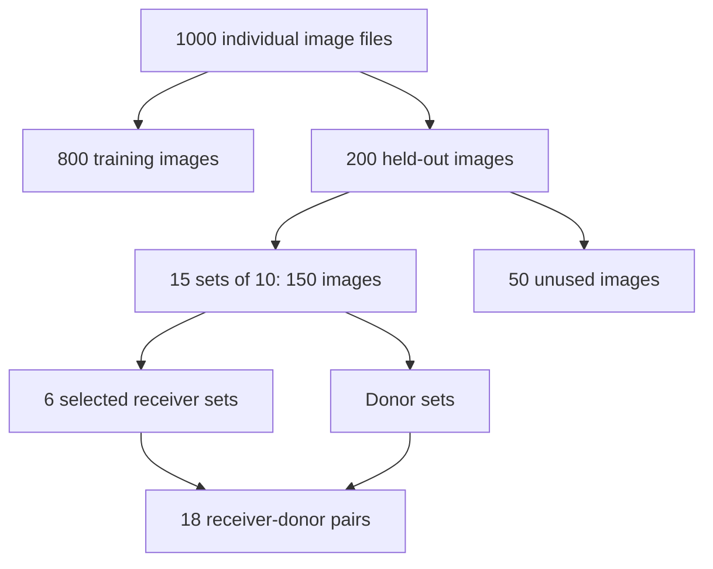
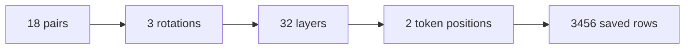
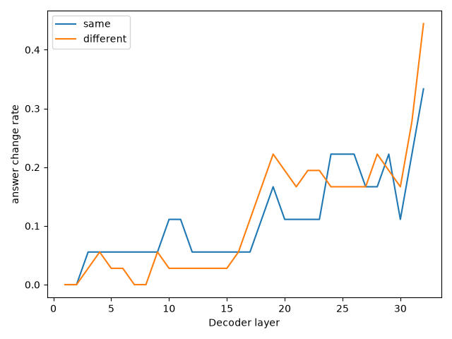
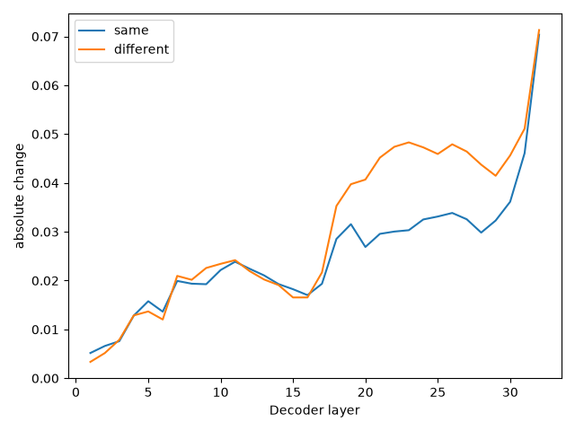

# 03 — Baseline activation patching

## 1. What are we trying to understand?

Suppose Qwen gives the right answer after seeing ten pictures. Did it work out the rule, spot one useful picture, or favour one answer label? Accuracy alone cannot tell us.

We use Qwen3.5-4B, a model that accepts pictures and text. We change a small part of its internal calculation and see whether its answer changes. This experiment is called **activation patching**. It tests whether that part can affect the answer. It does not directly tell us what calculation the model performs.

## 2. What is activation patching?

Imagine two picture sets. The first follows rule R1. The second follows R2. We call the first the **receiver**, because we change its calculation. We call the second the **donor**, because it supplies the replacement.

As the model processes an input, it builds lists of numbers. These lists are **activation vectors**. They describe the model's current internal state, but individual numbers do not come with readable meanings such as “this is R2.”

We run both sets normally. Then we run the receiver again and replace one of its vectors with the donor's vector. We ask: does the receiver's answer change? If it does, that vector can affect the answer. The donor might itself have answered incorrectly, so copying its answer is not necessarily a success.



A **probe** instead trains a small classifier to read saved vectors. It asks whether information can be read from them. Patching asks whether replacing them changes the model's answer. Neither test alone proves logical reasoning.

## 3. What are our images and logical rules?

A means a green cube is present. B means a blue sphere is present. C means a red cylinder is present. Other objects can distract the model.

Three bits record these facts, in A/B/C order. `001` means only C is present. The eight possibilities are `000`, `001`, `010`, `011`, `100`, `101`, `110`, and `111`.

| Rule | Expression |
|---|---|
| R1 | `(A AND B) OR C` |
| R2 | `(A AND C) OR B` |
| R3 | `(B AND C) OR A` |

AND requires both inputs. OR requires at least one. Parentheses tell us which part to calculate first.

One picture can satisfy several rules. For example, `111` satisfies all three. But `001` satisfies only R1; `010` only R2; and `100` only R3. We call these **decisive** pictures because one such positive example reveals the generating rule. Every constructed set contains its rule's decisive configuration. This is a shortcut: a model can choose the rule without checking the entire expression across all pictures.

The dataset contains 1,000 synthetic pictures: 125 visual variations of each bit pattern. The image generator varies the scenes while keeping these labels. See the [data-generation guide](../../code/00-data-generation/README.md) for the renderer and generation commands.

## 4. How did we divide and select the images?

This baseline uses the original dataset split: **800 training images and 200 held-out images**. Each bit pattern contributes 100 training and 25 held-out pictures. The metadata records the split; image variations below 100 are training and the remaining 25 are held out.

Patching trains no weights. We still use only held-out images to keep the evaluation separate from the training partition. The sampler constructs training sets too, but the patching runner selects only held-out sets.

The baseline imports `make_sets` from `probe_rules.py`. With seed 2026, it builds five ten-image held-out sets per rule. No image file occurs in two sets. Each set includes all five patterns that satisfy its rule. It adds three extra pictures of the decisive pattern and two extra shared patterns. That makes ten pictures, including four decisive ones.

Fifteen sets use 150 held-out images. The other 50 are left unused by this fixed, balanced sampling plan. They are not failed model trials or discarded errors.

The receivers are sets 00 and 01 for each rule: six receivers in total. A receiver at index `i` gets a same-rule donor at index `(i + 1) % 5`, plus a donor at index `i` from each other rule. Sets are sorted by set ID before this selection. In this run, only indices 00, 01 and 02 are needed as receivers or donors; all fifteen sets are nevertheless constructed and checked.



A picture file is not a set. A set contains ten files. The same set can appear in several pairs and many patching trials.

## 5. What exactly does Qwen receive?

It receives ten image inputs in the saved set order, followed by text. It does **not** receive the ground-truth bit strings. The bits are used to construct and check the sets, not to tell Qwen which objects are present.

For rotation 0, the complete text made by `build_input` is:

```text
Images 1-10 all satisfy ONE hidden Boolean rule.

A is true when a green cube is present.
B is true when a blue sphere is present.
C is true when a red cylinder is present.
Each concept requires the exact colour AND shape.
Any other object is an irrelevant distractor.

Candidate rules:
X: (A AND B) OR C
Y: (A AND C) OR B
Z: (B AND C) OR A

AND requires both inputs to be true.
OR requires at least one input to be true, including both.
Follow the parentheses.

Pick the rule consistent with every image.
Reply with nothing but its label: X, Y, or Z.
ANSWER:
```

The **processor** converts the pictures and text into tensors: arrays of numbers the model accepts. The baseline opens RGB images, limits their size to `384 * 28 * 28` pixels, puts the images before the text, and applies Qwen's chat template with thinking disabled. A **token** is one position in this prepared input. It need not correspond to a whole word. The template also adds positions that are not visible in the plain prompt above.

The model produces a score, called a **logit**, for each possible next token. The code selects only the scores for X, Y and Z. It checks that each label is one distinct token. **Softmax** converts these three scores into positive probabilities that sum to one. For illustration, scores `0, 0, 0` give one third each; scores `ln(2), 0, 0` give `0.50, 0.25, 0.25`.

These are probabilities **among X/Y/Z**, not among every possible output string. The largest gives the saved predicted rule after translating the label through the current mapping. No free-text explanation is generated for these trials.

The analysis rebuilt the exact ordered files from the saved configuration and matching dataset. Their combined fingerprint matches the original run. The [input manifest](baseline-analysis/derived/input_manifest.json) contains all nine evaluated sets and three rotations. Here is the real receiver `test_R1_00`; its rotation-0 prompt is the one above. The bit strings below are inspection labels, not model inputs.

| Order | Image file | A/B/C |
|---|---|---|
| 1 | `scene_001_109.png` | `001` |
| 2 | `scene_110_123.png` | `110` |
| 3 | `scene_011_100.png` | `011` |
| 4 | `scene_001_123.png` | `001` |
| 5 | `scene_101_106.png` | `101` |
| 6 | `scene_111_113.png` | `111` |
| 7 | `scene_011_114.png` | `011` |
| 8 | `scene_001_105.png` | `001` |
| 9 | `scene_001_104.png` | `001` |
| 10 | `scene_101_104.png` | `101` |


## 6. How does patching work inside the model?

A **decoder layer** is a processing block that updates token vectors. This run tests the outputs of 32 such blocks, numbered 1–32. Qwen has a hybrid architecture, so the code finds the decoder blocks rather than assuming they all have identical attention internals.

A **forward pass** is one calculation from the prepared input to the answer scores. The code first makes normal passes for all sets needed in each answer rotation. It saves the last two token vectors from every layer on the CPU, along with predictions and probabilities.

It then starts a fresh receiver pass. At one chosen layer, it replaces one receiver token vector with the corresponding donor vector. The later layers continue from that changed state. It does not start from a partially saved whole model state.

A **forward hook** is a PyTorch callback run when a layer produces its output. This excerpt comes from `patched_probabilities`:

```python
vector = donor_vector.to(device=hidden.device, dtype=hidden.dtype)
changed = hidden.clone()
changed[:, token_index, :] = vector
```

The first line puts the donor vector on the same device and uses the same number format as the receiver. The second copies the receiver output so the saved original is not edited. The third replaces every feature at one token position for the single receiver in this batch. The hook returns this changed output, preserving any other items the layer returned. A `finally` block removes the hook after the pass, even if an error occurs.

The replacement affects one token vector, not every token or every layer. Later calculations can respond to it. The pictures, prompt, chosen answer mapping and all learned model weights stay unchanged.

## 7. What are same-rule and different-rule patches?

A **same-rule** pair might have an R1 receiver and a different R1 donor. This is a control: it measures the effect of changing vectors without changing the generating rule. Its vectors can still differ because the pictures, object arrangements and image order differ.

A **different-rule** pair might have an R1 receiver and an R2 donor. We ask whether the receiver becomes more likely to choose R2. R2 is the donor's **true rule**: the rule used to select its pictures. The donor's **predicted rule** is what Qwen actually chose. These may differ. The receiver also has its own true and predicted rules.

A changed answer alone does not establish correct transfer. It might copy a wrong donor answer or reflect an answer-label preference.

For illustration only, an R1 receiver could change from `(R1=.60, R2=.25, R3=.15)` to `(.45, .40, .15)` after an R2 patch. The donor's true-rule probability rose by `.15`, or 15 percentage points. The answer is still R1. This is not a saved measurement from the completed run.

## 8. Why test different layers, token positions and answer orders?

Different layers may affect the answer differently. We patch each layer separately; a trial never patches all layers at once.

The **final token** is the last prepared input position, whose output is used to score the next answer token. It is not the generated answer letter. The **previous token** is the position immediately before it. Patching that position checks whether an effect depends on choosing the final position. It is an additional control, not an equally influential position by design. Its influence can reach the final position through later layers. At the last layer there is no later decoder block to carry that change forward.

We also rotate the rule-to-label mapping:

| Rotation | X | Y | Z |
|---|---|---|---|
| 0 | R1 | R2 | R3 |
| 1 | R2 | R3 | R1 |
| 2 | R3 | R1 | R2 |

The images stay in the same order. The donor and receiver use the same mapping in a trial. This helps separate a preference for a rule from a preference for X, Y or Z. Three cyclic rotations are not all six possible permutations.

## 9. How do we get 3,456 trials?

One **trial** is one donor–receiver pair, answer rotation, decoder layer and token position. Normal passes that record original answers are additional work, not patching trials.

| Choice | Count |
|---|---:|
| Held-out sets constructed | 15: five per rule |
| Receivers selected | 6: two per rule |
| Donors per receiver | 3: one same-rule and two different-rule |
| Pairs | 18: six same-rule and twelve different-rule |
| Answer rotations | 3 |
| Layers | 32 |
| Positions | 2: final and previous |

**18 × 3 × 32 × 2 = 3,456 saved patching rows.** These reuse the same small collection of sets. They are not 3,456 independent picture sets.



The actual code loops over rotations first, then pairs, layers and positions. The diagram shows the factors, not a different implementation order.

## 10. What does each output file contain?

Original files remain in:

```text
results/activation_patching/qwen3_5/dataset-v1/pairs2_rot3_prev1/
```

| File | Contents |
|---|---|
| `config.json` | Model, precision, seed, pair plan, input fingerprint, controls and run settings |
| `patches.csv` | One row for each saved patching trial |
| `layer_effects.csv` | Count, signed mean and standard deviation of donor-rule probability change, grouped by condition, position and layer |
| `layer_effects.png` | Plot of those signed means |
| `summary.json` | Descriptive peak/step results and the chosen control-cutoff check |

In `patches.csv`, `receiver_rule` and `donor_rule` are generating rules. The three `*_prediction` columns hold original receiver, original donor and patched receiver predictions. `receiver_correct` and `donor_correct` compare original answers with generating rules.

`receiver_p_donor_rule` is the receiver's original probability for the donor's true rule. `patched_p_donor_rule` is its probability after patching. Their difference is `delta_p_donor_rule`. A positive value means the donor's true rule gained probability; a negative value means it lost probability. Near zero means little net change in that score, not necessarily no internal change.

The receiver-rule probability columns use the receiver's true rule as target instead. In same-rule pairs these targets are identical. In different-rule pairs they differ. This matters when comparing condition averages: “toward donor” means preserving the receiver's rule in one condition and favouring another rule in the other.

`changed_answer` is 1 when the predicted rule changed. `changed_to_donor_rule` is 1 only for a different-rule pair where the receiver did not already predict the donor's true rule and changes to that rule.

Signed changes can cancel: `+.20` and `-.20` average to zero, although both are large. The separate analysis also reports absolute changes, which measure size without direction.

The CSV does not save every probability vector. For different-rule receiver/patched records, two distinct probabilities are saved, so the third can be reconstructed as `1 - p1 - p2`. For same-rule pairs those two columns name the same rule. The other two probabilities cannot be recovered. The donor record saves only its own true-rule probability. Missing values must remain unknown.

## 11. What did our actual results show?

The full baseline is complete. The uploaded archive contains both a smoke test and the full run. This analysis uses only `pairs2_rot3_prev1`. All **3,456 full-run records** passed checks against the saved configuration and dataset fingerprint. The signed means also match the original layer summary. The following findings were checked against the raw CSV:

- Later-layer patches change answers more often. Same-rule patches also change answers, so changing an answer is not specific evidence that another rule was transferred.
- The model shows answer-option and rule bias. An answer can reflect a preference for a label or rule rather than consistent use of the pictures.
- Layer 6 has the highest signed average different-rule effect because its average is the **least negative**. This does not mean it gives the strongest positive transfer or is a reasoning layer.
- No layer passed the chosen `0.05` control cutoff. This is a five-percentage-point effect-size check, not a statistical significance test. The code requires a positive different-rule effect of at least `.05`, and a margin of at least `.05` over the absolute same-rule and previous-token effects.
- At layer 32, all 54 final-token patches reproduce the donor's predicted answer. Of the 36 different-rule trials there, 16 change the receiver's answer and seven change it to the donor's true rule. Copying the donor's prediction is therefore not the same as copying the correct rule.
- The layer-32 mean absolute donor-rule changes are about 7.04 percentage points for same-rule and 7.13 for different-rule patches. Similar sizes do not show a clear rule-specific effect.

The last-layer result also needs architectural context: replacing the final token at the last decoder output puts the donor's vector directly before the final answer readout. Copying its answer at this point does not show where the model worked out a rule.

The original answers also show bias: among nine evaluated sets and three answer orders, the model predicts R3 18 times, R1 six times and R2 three times. These 27 original predictions include donor-only sets. In rotation 1, all nine answers are R3, which is label Y in that mapping.

Here is one real trial: `test_R1_00__different__test_R2_00`, rotation 0, layer 32, final token. The receiver originally chooses R2. The donor chooses R3 even though its true rule is R2. The patched receiver also chooses R3.

| Receiver probabilities | Before | After |
|---|---:|---:|
| R1 | 16.48% | 17.14% |
| R2, donor's true rule | 42.74% | 36.28% |
| R3, donor's predicted rule | 40.78% | 46.58% |

R1 and R2 are saved values. R3 is reconstructed as one minus their sum. The patch copies the donor's answer while **reducing** the probability of its true rule by 6.46 percentage points. This illustrates why answer changes and correct rule transfer must be measured separately.



Each curve shows the fraction of final-token trials where the answer changes. These trials reuse the same image sets. At layer 32, six of 18 same-rule patches and 16 of 36 different-rule patches change the answer.



This graph ignores the sign of each donor-rule change before averaging. Similar-sized effects occur in both conditions; size alone does not establish a rule-specific effect.

See the [analysis folder](baseline-analysis/README.md) for original files, the remaining graphs, exact values and a CPU notebook.

## 12. What can and cannot be concluded?

Patching tests whether changing a vector affects an answer. This is evidence of **causal influence**: the deliberate change can cause a different output. It is not evidence that the vector represents a particular Boolean calculation.

The baseline does not identify a clear rule-specific reasoning layer. Answer bias, decisive-image shortcuts, same-rule changes and repeated use of the same sets limit the interpretation. The largest effect or least negative mean is not automatically the place where reasoning happens. Failing a chosen threshold also does not prove that every layer contains no useful rule information.

## 13. How can someone reproduce or inspect the experiment?

The original code is [patch_activations_qwen35.py](../../code/03-activation-patching/patch_activations_qwen35.py). Its sampling comes from `make_sets` in [probe_rules.py](../../code/02-probing/probe_rules.py), and its image prompt and processor adapter come from [operator_controls_qwen35.py](../../code/01-operator-controls/operator_controls_qwen35.py). This explanation was checked against those baseline functions, not the newer shared patching runner.

Do not rerun Qwen just to inspect the saved results. Copy the original four CSV/JSON files into a local source directory, obtain the matching dataset, and use the separate CPU analysis command in [baseline-analysis/README.md](baseline-analysis/README.md). It checks all 3,456 rows, rebuilds ordered inputs, compares the saved fingerprint, and writes new outputs elsewhere. The original files stay unchanged.

For a data-only check from the repository root:

```bash
python three-operand-experiments/code/03-activation-patching/patch_activations_qwen35.py --data-dir /path/to/data-1000 --validate-only
python three-operand-experiments/code/03-activation-patching/test_patching.py
```

For reference, the completed run's command uses these flags. Do not launch it again against the existing results just to read them:

```bash
python three-operand-experiments/code/03-activation-patching/patch_activations_qwen35.py \
  --data-dir /path/to/data-1000 \
  --experiment-dir '/content/drive/MyDrive/LogicCBM++/looking-beyond-attention/three-operand-experiments/results' \
  --pairs-per-rule 2 --rotations 3 --previous-token-control
```

It requires a compatible GPU environment and the dependencies in `code/requirements-qwen35.txt`. The runner checks its configuration before resuming and skips saved trial keys. The smaller `--smoke-test` uses two pairs and first/last layers in a separate folder. No model run was launched for this documentation or analysis work.

### Open the results notebook

Open [explore_baseline.ipynb](baseline-analysis/explore_baseline.ipynb) in Jupyter or Colab. Run its cells in order. Edit four values to choose a pair, answer rotation, layer and token position. It shows the saved answers and labels each probability as saved, reconstructed or unavailable. It uses pandas, matplotlib and Pillow. It does not need Qwen, PyTorch, Transformers, a GPU or a Drive login.

After cloning, start Jupyter in the repository and open the notebook. In Colab, clone this feature branch into the runtime and open the notebook from that checkout. Run from the checkout root or the notebook folder; paths are found automatically. The notebook never downloads data or asks for authentication. To see images, download dataset-v1 from the GitHub Release and put it in `three-operand-experiments/data-1000/`. Numbers and plots still work without images.
