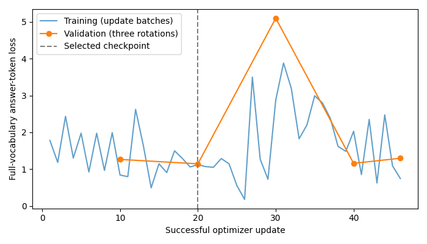
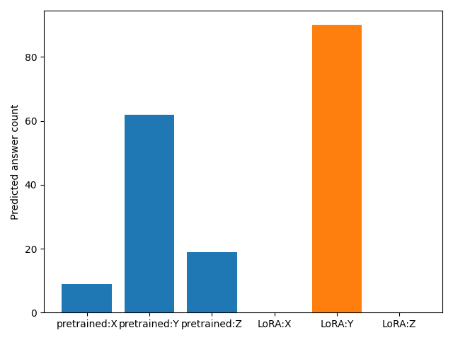
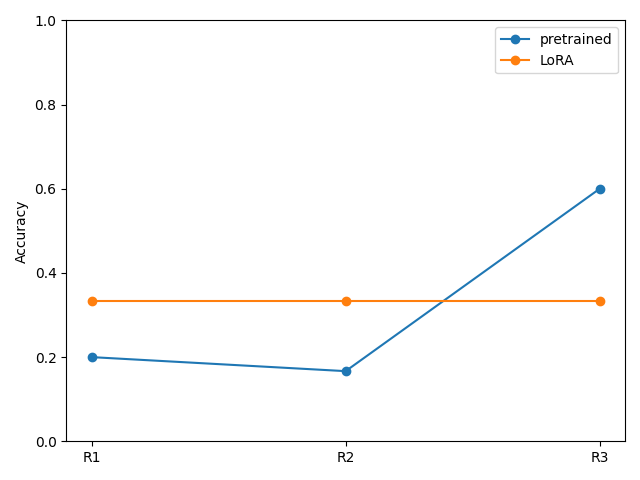
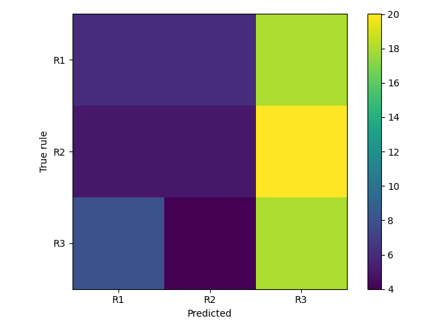
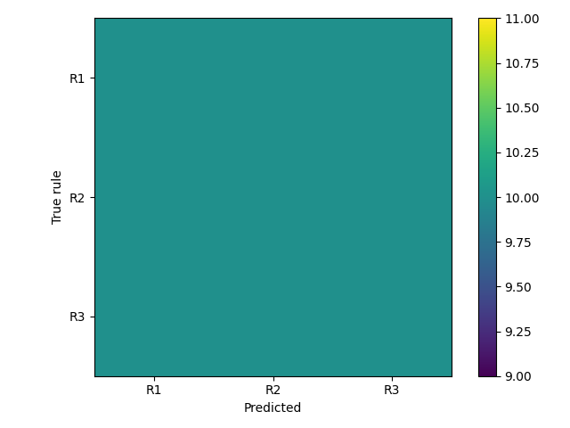

# Experiment 04 — QLoRA training changed the model, but its answers collapsed to Y

## Research question

Can a small amount of task-specific training help Qwen3.5-4B identify a Boolean rule from pictures? We fine-tuned small QLoRA adapters and compared the selected adapter with the pretrained model on **exactly the same validation images and option orders**.

Training completed and changed the adapter weights. Validation accuracy moved from **29/90 (32.22%) to 30/90 (33.33%)**, but the selected adapter answered **Y on every trial**. This is the central finding: the experiment does **not demonstrate that the model learned the Boolean rules**.

## Experimental setup: one question, ten pictures, three rules

Each picture may contain three relevant objects:

- **A:** a green cube.
- **B:** a blue sphere.
- **C:** a red cylinder.

Other objects are distractions. The model sees ten actual images, all satisfying one hidden rule, and chooses among these candidates:

| Rule | Boolean expression | A revealing example |
|---|---|---|
| R1 | `(A AND B) OR C` | Only C present (`001`) satisfies R1 alone |
| R2 | `(A AND C) OR B` | Only B present (`010`) satisfies R2 alone |
| R3 | `(B AND C) OR A` | Only A present (`100`) satisfies R3 alone |

For example, an R1 set includes pictures with C alone as well as other configurations satisfying R1. Each set contains all five satisfying A/B/C configurations, then five additional satisfying images, with no duplicate image inside the set. The model receives the pictures and object definitions, **not** the A/B/C labels used to construct the sets. The task is positive-only: it contains no negative examples. A decisive picture can distinguish the candidate rules, so success would not itself establish reasoning over all ten images.

The fixed dataset has 1,000 images, 125 for each of the eight A/B/C configurations. Seed **2026** preserves the original 800 training images and divides the held-out 200 into balanced validation and test pools.

| Partition | Distinct images | Ten-image sets | Sets per rule |
|---|---:|---:|---:|
| Training | 800 | 90 | 30 |
| Validation | 100 | 30 | 10 |
| Test | 100 | 30 | 10 |

Images never cross partitions, but sets **reuse images within a partition**. The [fixed manifest](results/rule_identification_manifest.json) records the sets, image fingerprints and split. These are 90 training **sets**, not 90 individual images.

Training uses each set's saved option mapping, balanced across X/Y/Z, for both epochs. Validation repeats every set in three cyclic option orders. If an R1 set is shown with mappings `X=R1,Y=R2,Z=R3`, then `X=R2,Y=R3,Z=R1`, then `X=R3,Y=R1,Z=R2`, its correct letters are X, Z and Y. A model identifying the rule should keep choosing R1 as its letter changes.

Thus validation has **30 sets × 3 rotations = 90 trials**. The rotations are repeated measurements, not independent examples. **Every accuracy in this report is validation accuracy. The final-test partition remains untouched.**

## Training method: small adapters on a frozen quantized model

QLoRA keeps the large base model frozen in 4-bit form and trains small low-rank additions to selected linear layers. For a weight matrix W, the adapter adds a scaled product of two smaller matrices. This reduces the trainable parameter and memory requirements while allowing the language model's behavior to change.

We used **Qwen/Qwen3.5-4B** at fixed revision [`851bf6e806efd8d0a36b00ddf55e13ccb7b8cd0a`](results/model_revision.txt). The successful configuration is saved in [training/config.json](results/training/config.json).

| Setting | Successful experiment |
|---|---|
| Quantization | 4-bit NF4, double quantization, FP16 compute |
| LoRA | Rank 8, alpha 16, dropout 0.05 |
| Targets | Language-model attention and MLP linear layers; vision encoder frozen |
| Optimizer | PyTorch AdamW, constant learning rate 0.0002; default betas (0.9, 0.999), epsilon 1e-8, weight decay 0.01 |
| Training | 90 sets, two epochs, one set per microbatch, gradient accumulation 4 |
| Numerical settings | Initial AMP gradient scale **8**, gradient clipping norm 1 |
| Input limits | 100,352 pixels per image; 16,000 token guard |
| Validation/checkpoints | Every 10 updates, plus final validation |
| Selection | Lowest validation full-vocabulary answer-token loss over three rotations |

Only the answer tokens contribute to the training loss; the image and prompt tokens are masked. Checkpoint selection uses the answer's probability under the **full vocabulary**, not validation accuracy. Evaluation separately scores X/Y/Z by conditional answer-sequence likelihood and normalizes those three scores into saved probabilities. These probabilities are relative choice scores, not calibrated probabilities of logical understanding.

### Evidence that training succeeded

The [completion record](results/training/complete.json) and [update log](results/training/losses.jsonl) show **46 successful optimizer updates**. All **248 LoRA B matrices changed at every update**. With accumulation 4, each epoch has 23 updates, including its final partial batch. The [trainable parameter inventory](results/training/trainable.json) records the adapter scope.

The lowest recorded validation loss was **1.1470619327492184 at step 20**, which selected the adapter reported below; see [selection.json](results/training/selection.json). The final step was not the selected checkpoint. Training updates succeeded, but this alone says nothing about rule learning.



The [CPU-generated loss curve](results/derived/loss_curve.png) uses the actual logged update losses and validation observations. Training points cover changing batches; validation points cover all validation rotations, so their values are not directly interchangeable.

## Results: a one-answer gain hides a stronger position bias

| Model | Correct / trials | Validation accuracy | Difference from pretrained |
|---|---:|---:|---:|
| Pretrained | 29/90 | 32.22% | — |
| Selected QLoRA adapter | 30/90 | 33.33% | +1.11 percentage points |
| Uniform-choice chance reference | — | 33.33% | — |

The [saved comparison](results/comparison/comparison.json) and [matched trial table](results/comparison/matched_predictions.csv) compare identical examples. The one additional correct answer is not persuasive evidence of improvement: the selected adapter simply chose the middle answer label every time.

| Predicted letter | Pretrained | Selected QLoRA |
|---|---:|---:|
| X | 9 | 0 |
| Y | 62 | **90** |
| Z | 19 | 0 |



The pretrained model already favored Y. Fine-tuning made that bias complete on this validation evaluation: **every saved answer is Y, across all image sets and all rotations**. This observed invariance does not prove the model ignores images under every possible input; it describes the evaluated examples.

### Per-rule performance and confusion matrices

| True rule | Pretrained correct | Pretrained accuracy | QLoRA correct | QLoRA accuracy |
|---|---:|---:|---:|---:|
| R1 | 6/30 | 20.00% | 10/30 | 33.33% |
| R2 | 5/30 | 16.67% | 10/30 | 33.33% |
| R3 | 18/30 | 60.00% | 10/30 | 33.33% |



In the matrices, rows are true rules and columns are predicted rules, both ordered R1, R2, R3. The pretrained counts are `[6,6,18]`, `[5,5,20]`, `[8,4,18]`. It often predicted R3.



After fine-tuning, **every row is `[10,10,10]`**. This apparent balance comes from rotating which rule is labeled Y, not from distinguishing the rules correctly.



### What happened to the 28 changed predictions?

| Transition | Trials |
|---|---:|
| Wrong → correct | 11 |
| Correct → wrong | 10 |
| Wrong → different wrong | 7 |
| **Total changed** | **28** |

The remaining 62 predictions stayed the same. The net gain is **11 − 10 = 1** correct trial. The [matched CSV](results/comparison/matched_predictions.csv) includes every trial and its probability changes; the [derived analysis](results/derived/analysis.json) verifies these transitions from the raw predictions.

### One real set across three rotations

Consider **validation_R1_00**, whose true rule is R1. Its ten saved image filenames are:

```text
scene_110_121.png, scene_111_124.png, scene_110_116.png,
scene_001_100.png, scene_011_120.png, scene_101_111.png,
scene_101_123.png, scene_111_101.png, scene_001_109.png,
scene_001_101.png
```

The same images appear in the same order in each rotation. The table reports saved probabilities in **R1/R2/R3 order**, rounded to nine decimal places for display. Full precision is retained in both [pretrained](results/pretrained/predictions.jsonl) and [fine-tuned](results/finetuned/predictions.jsonl) files and in the [extracted example](results/derived/analysis.json).

| Rotation | X / Y / Z rules | Correct letter | Pretrained probabilities R1 / R2 / R3 | Pretrained answer | QLoRA probabilities R1 / R2 / R3 | QLoRA answer |
|---|---|---|---|---|---|---|
| 0 | R1 / R2 / R3 | X | 0.205451950 / 0.338732988 / 0.455815077 | Z → R3 | 0.209831834 / 0.444213986 / 0.345954210 | Y → R2 |
| 1 | R2 / R3 / R1 | Z | 0.314919680 / 0.173915178 / 0.511165142 | Y → R3 | 0.349498123 / 0.208694860 / 0.441807002 | Y → R3 |
| 2 | R3 / R1 / R2 | Y | 0.319353282 / 0.324382365 / 0.356264353 | X → R3 | 0.441807002 / 0.349498123 / 0.208694860 | Y → R1 |

The pretrained model consistently chose the wrong **rule**, R3, using three different letters. The adapter consistently chose the same **letter**, Y, which meant three different rules. It was correct only when R1 occupied Y.

### Rotation consistency: Y=90 is the key finding

We call a set rule-consistent when all three rotations predict the **same rule**, after translating letters through each option mapping. Consistency need not imply correctness, as the example above shows.

| Model | Rule-consistent sets | Rate |
|---|---:|---:|
| Pretrained | 6/30 | 20.00% |
| Selected QLoRA | **0/30** | **0.00%** |

Always answering Y guarantees one correct rotation per set and zero rule consistency. It explains the 33.33% aggregate accuracy and all three equal per-rule accuracies without requiring rule identification.

A paired set-clustered percentile bootstrap (seed **2026**, **20,000** resamples) retains each set's three rotations and resamples the same sets for both models. Its descriptive 95% intervals are **22.22–42.22%** for pretrained accuracy, **33.33–33.33%** for QLoRA accuracy, and **−8.89 to +11.11 percentage points** for the paired difference. The degenerate QLoRA interval follows from getting exactly one of three rotations correct in every set; it does not indicate certainty about future data.

These intervals account for rotations within sets but **do not account for shared images across sets**, checkpoint selection, or training-seed variability. They are not a formal demonstration of improvement or a population-level guarantee.

## Interpretation, limitations and future diagnostics

The adapter changed, but its selected checkpoint showed answer-position collapse. Lower answer-token validation loss did not translate into demonstrated rule identification. A plausible diagnostic direction is to examine how full-vocabulary answer loss and relative X/Y/Z scores evolve at each checkpoint; this experiment does not establish the cause of the collapse.

This is a small pilot with one training run and one validation-selected adapter. Its positive-only task admits decisive-image shortcuts. Reused images introduce dependence, and selecting on validation means these are not unbiased final-test results. Rule consistency measures resistance to option rotation, not Boolean understanding. Adapter weights and source images are omitted from this small results release.

Useful future diagnostics include comparing checkpoint accuracy, answer balance and rule consistency alongside loss; evaluating shuffled option orders during training; testing image ablations or mismatches to probe visual dependence; and running multiple seeds with richer positive/negative evidence. Such studies would be new experiments. No GPU inference, retraining, activation patching or final-test evaluation was performed for this publication.

## Reproduction

### Recheck the published results on CPU

From the repository root, install NumPy and Matplotlib in a Python environment, then run:

```bash
python -m pip install numpy matplotlib
python three-operand-experiments/code/04-lora/analyze_results.py \
  --results three-operand-experiments/experiments/04-lora/results \
  --output /tmp/experiment04-analysis
python -m unittest discover -s three-operand-experiments/tests -p 'test_lora_results.py'
```

This checks matched IDs, mappings, probabilities, correctness, saved metrics, CSV deltas, successful updates and checkpoint selection. It regenerates the analysis and loss curve without loading model weights. All four original comparison PNGs were regenerated from the raw predictions and verified pixel for pixel before publication.

### Repeat the training and validation protocol

A new training run requires a suitable GPU and the original `data-1000` dataset (`metadata.json` and `images/`). Put the dataset at a configurable location, create a fresh results directory, and use the committed manifest. Install the [model requirements](../../code/04-lora/requirements.txt); the saved configs record the original software versions. No personal paths or saved run IDs are required.

```bash
EXP=three-operand-experiments
DATA=/path/to/data-1000
OUT=/path/to/fresh-results
MANIFEST="$EXP/experiments/04-lora/results/rule_identification_manifest.json"
REVISION=$(cat "$EXP/experiments/04-lora/results/model_revision.txt")
python "$EXP/code/04-lora/build_training_sets.py" \
  --data-dir "$DATA" --manifest "$MANIFEST" --validate-only
python "$EXP/code/04-lora/evaluate_lora.py" \
  --data-dir "$DATA" --manifest "$MANIFEST" --revision "$REVISION" \
  --precision 4bit --partition validation --output-root "$OUT/pretrained"
python "$EXP/code/04-lora/train_lora.py" \
  --data-dir "$DATA" --manifest "$MANIFEST" --revision "$REVISION" \
  --precision 4bit --epochs 2 --initial-gradient-scale 8 \
  --output-root "$OUT/training"
```

Each command writes a configuration-addressed subdirectory. Set `BASELINE_RUN` to the emitted pretrained directory and `TRAINING_RUN` to the emitted training directory. Evaluate `--adapter "$TRAINING_RUN/best_adapter"` with the same evaluation command, validation partition and `--output-root "$OUT/finetuned"`. Set `FINETUNED_RUN` to that emitted directory, then compare:

```bash
python "$EXP/code/04-lora/compare_predictions.py" \
  --baseline "$BASELINE_RUN" --finetuned "$FINETUNED_RUN" \
  --output "$OUT/comparison"
```

Keep the final-test partition reserved. Hardware and library differences can affect numerical results; these instructions describe the protocol, not a guarantee of identical training outcomes.

### Technical record and artifact index

The original software record is PyTorch **2.11.0+cu130**, Transformers **5.22.0**, PEFT **0.21.2** and bitsandbytes **0.50.2**, with source commit `680e8a7d51ac36b08c60e11cc0ee7280404ee65d`. The [pretrained config](results/pretrained/config.json) and [fine-tuned config](results/finetuned/config.json) retain matching prompt hashes, manifest hashes, model settings and adapter fingerprints. The [source provenance](results/provenance.json) links every copied artifact to Drive and records its SHA-256; original paths inside raw records are provenance only.

| Record | Committed files |
|---|---|
| Pretrained validation | [Metrics](results/pretrained/metrics.json), [raw predictions](results/pretrained/predictions.jsonl) |
| Selected QLoRA validation | [Metrics](results/finetuned/metrics.json), [raw predictions](results/finetuned/predictions.jsonl) |
| Matched comparison | [Summary](results/comparison/comparison.json), [trial table](results/comparison/matched_predictions.csv) |
| Training evidence | [Losses](results/training/losses.jsonl), [completion](results/training/complete.json), [selection](results/training/selection.json), [trainable parameters](results/training/trainable.json), [configuration](results/training/config.json) |
| Fixed inputs | [Model revision](results/model_revision.txt), [single manifest](results/rule_identification_manifest.json) |
| CPU analysis | [Statistics and full-precision example](results/derived/analysis.json), [analysis code](../../code/04-lora/analyze_results.py), [tests](../../tests/test_lora_results.py) |
| Figures | [Loss](results/derived/loss_curve.png), [answer bias](results/comparison/answer_bias.png), [per-rule accuracy](results/comparison/per_rule_accuracy.png), [pretrained confusion](results/comparison/pretrained_confusion.png), [QLoRA confusion](results/comparison/LoRA_confusion.png) |

Only the successful Experiment 04 artifacts are included. The results directory contains no adapter weights, checkpoints, optimizer binaries, source images, duplicate manifests or caches.
